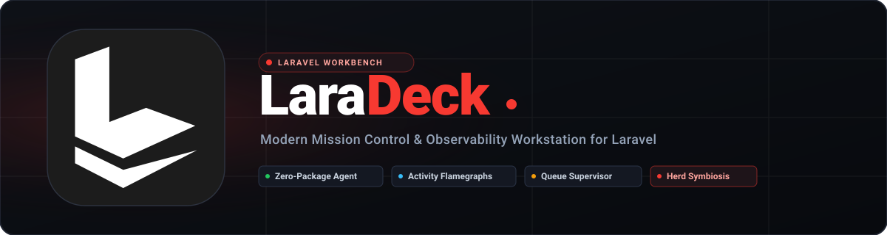

<div align="center">

<picture>
  <source media="(prefers-color-scheme: dark)" srcset="docs/images/laradeck-banner.svg">
  
</picture>

<br/>
<br/>

[](LICENSE)
[](https://github.com/HassanSalah120/laradeck)
[](https://golang.org)
[](https://reactjs.org)
[](https://vitejs.dev)
[](https://wails.io)
[](https://www.typescriptlang.org)

**LaraDeck** is a modern, local-first developer companion and observability workstation for Laravel developers. Engineered to operate in seamless symbiosis with **Laravel Herd**, LaraDeck adds deep runtime observability, zero-package debugger instrumentation, microsecond activity flamegraphs, constructor-based event dispatching, queue supervisors, pre-flight webhook diagnostics, 1-click performance checkups, authenticated load testing, and an interactive database ERD canvas.

[Features](#-key-features) • [Herd Symbiosis](#-symbiosis-with-laravel-herd) • [Installation](#-installation--requirements) • [Building from Source](#-building-from-source) • [Architecture](#-architecture) • [Documentation](#-documentation)

</div>

---

## 🌟 Key Features

```
┌─────────────────────────────────────────────────────────────────────────────┐
│                            LARADECK AT A GLANCE                             │
├──────────────────────────────────────┬──────────────────────────────────────┤
│ 🔍 Zero-Package Debugger Agent       │ ⚡ Microsecond Activity Flamegraphs   │
│ 📨 In-App Variable Dumps & Streams   │ 🎯 Event Constructor Reflection      │
│ ⏱️ Jobs Pro Workbench (Run Now/Queue) │ 🛡️ Queue Worker Process Supervisor   │
│ 🪝 Webhook Pre-Flight Diagnostics    │ 🔁 HMAC-Signed Webhook Replay        │
│ 📊 Performance Radar & 1-Click Fixes │ 🚀 Authenticated HTTP Load Tester    │
│ ⚙️ 3-Tier PHP & Live ini_get Checks  │ 🗄️ Database Studio & ERD Canvas      │
│ 🧪 Interactive Tinker REPL           │ 📡 Reverb & WebSocket Inspector      │
│ 🤖 Model Context Protocol (MCP)      │ 🌐 Desktop App + Browser Dashboard   │
└──────────────────────────────────────┴──────────────────────────────────────┘
```

### 1. Zero-Package Debugger Agent & Dumps Stream
- **Zero Composer Dependencies**: Attaches non-intrusively via PHP's `auto_prepend_file` directive in `public/.user.ini`. Your `composer.json` remains completely untouched.
- **In-App Variable Dumps**: Intercepts Symfony's `VarDumper` (`dump()` and `dd()`), streaming structured data into LaraDeck's interface in real time without halting HTTP web requests.
- **Dumps In HTML Response Toggle**: 1-click switch between capturing dumps inside the LaraDeck desktop UI or streaming them inline into the browser HTTP response.
- **Request Telemetry Frames**: Automatically records every HTTP request lifecycle, capturing status code, execution duration (ms), peak memory usage (MB), executed SQL queries, and log messages.

### 2. Microsecond Activity Tracing & Flamegraph Timeline
- **Hierarchical Call Trees**: Microsecond chronology detailing HTTP middleware, controllers, Eloquent queries, domain events, listeners, and Blade/Inertia views.
- **Framework vs App Code Segregation**: Toggle **Filter Framework Spans** to hide standard vendor middleware and framework internals, isolating your team's application logic.
- **Interactive Offline HTML Export**: Export standalone, self-contained CSS flamegraph reports to share with teammates or attach to GitHub pull requests.

### 3. Events & Queues Pro Workbench
- **Reflection-Based Parameter Forms**: Automatically reflects event and job class constructors, generating dynamic input forms with types, defaults, and nullable indicators.
- **Dispatched-From Code Locator**: Scans project PHP files for AST and regex references where `event(new ...)` or `Job::dispatch(...)` is called, presenting direct file and line links.
- **Raw PHP Expression Mode**: Allows instantiating complex parameters using live expressions (e.g., `User::first()`, `Order::factory()->make()`).
- **Jobs Workbench — "Run Now" vs "Queue It"**:
  - **Run Now**: Executes a job's `handle()` method synchronously inside a runner session, returning stdout, execution duration, and query count immediately.
  - **Queue It**: Pushes the job payload into the background queue worker.
- **Queue Worker Supervisor**: Manage local `artisan queue:listen` worker daemons with real-time log output and PID controls.
- **Failed Jobs Manager**: Filter failed jobs, inspect exception stack traces, and trigger individual or bulk retries.

### 4. Webhook Pre-Flight Diagnostics & Signed Replay
- **Automated Route Discovery**: Discovers webhook endpoints across the application (`stripe`, `github`, `shopify`, `paddle`, generic).
- **CSRF Trap Detection**: Flags endpoints running through `web` middleware without CSRF exclusions, generating a 1-click copy snippet for `bootstrap/app.php`:
  ```php
  ->validateCsrfTokens(except: [
      'api/webhooks/*',
  ])
  ```
- **Auth Trap Warning**: Warns if webhook routes are gated behind `auth` or `auth:sanctum` middleware that would reject incoming payloads with 401 or 302 redirects.
- **Secret Key Verification**: Audits whether signing secrets exist in `.env` (e.g., `STRIPE_WEBHOOK_SECRET`).
- **Plain-English HTTP Status Explanations**: Diagnoses status codes (419 CSRF mismatch, 302 unauthenticated login redirects, 401/403 signature mismatches, 500 exceptions).
- **Multi-Provider Test Dispatcher**: Generates valid HMAC-SHA256 signatures for Stripe (`Stripe-Signature`), GitHub (`X-Hub-Signature-256`), Shopify, and Paddle.

### 5. Performance Radar & Authenticated Load Tester
- **Health Checkup & 1-Click Fixes**: Scored project audit (0–100) with automated 1-click remediation:
  - Route caching (`route:cache`)
  - Config caching (`config:cache`)
  - Event caching (`event:cache`)
  - View caching (`view:cache`)
  - Autoloader optimization (`composer dump-autoload -o`)
  - Profiler overhead warnings (detects active Barryvdh Debugbar / Clockwork in production)
  - Driver checks (warns against `database` or `sync` session/queue drivers under high concurrency)
  - OPcache verification
- **Authenticated High-Performance Load Tester**:
  - High-throughput native concurrent Go benchmarking engine (no k6 or third-party tools required).
  - **1-Click User Authentication**: Generates authentic session cookies or Sanctum bearer tokens for a specified User ID / email via Laravel's session manager.
  - **3xx Redirect Detection**: Warns if >50% of requests are HTTP redirects, preventing false benchmarks against `/login`.
  - **500ms Sampling Timeline**: Interactive sparkline chart visualizing throughput (RPS) and latency percentiles over elapsed time.

### 6. 3-Tier PHP & Composer Manager
- **3-Tier INI Directive Management**:
  - **Tier 1 (Global)**: Modify version-wide `php.ini`.
  - **Tier 2 (Site-Isolated)**: Save overrides to project-local `.user.ini`.
  - **Tier 3 (Live Feedback)**: Displays active `ini_get` values ("Now: 512M") so developers immediately confirm effective runtime values.
- **Standalone Windows PHP Runtimes**: Downloads and configures official Windows PHP binaries (8.1, 8.2, 8.3, 8.4 x64 NTS) from `windows.php.net`.
- **Herd Isolation**: 1-click site isolation using Herd's installed CLI (`herd isolate <ver>`).
- **Composer Management**: Downloads official `composer.phar` and creates CLI shims in `%USERPROFILE%/.laradeck/bin` with 1-click PATH integration.

### 7. Database Studio & ERD Canvas
- **Model Explorer**: Inspects Eloquent models, table attributes, casts, and database relationships.
- **Interactive ERD Canvas**: Visualizes database schema, primary/foreign keys, and table relationships.
- **Typed Updates with Safety Interlocks**: Edit records safely with rollback protection and safety guards.
- **EXPLAIN Query Plan Analyzer**: Identifies bottlenecks, missing indexes, and full table scans.

### 8. Tinker REPL & Query Inspector
- Interactive PHP execution sandbox with live variable inspection, query logging, and execution timing.

### 9. Real-Time Reverb & WebSocket Inspector
- Inspect live WebSocket frames and simulate event broadcasts over Laravel Reverb.

### 10. Remote Profiles & Multi-Environment Bastions
- SSH tunnel profiles, safety policies, and production write protections for remote environments.

### 11. Model Context Protocol (MCP) AI Server
- Built-in MCP server over `stdio` allowing AI coding assistants (Antigravity, Cursor, Claude Desktop) to query project models, routes, and database schemas with explicit project trust.

### 12. Dual Platform Delivery (Desktop + Browser)
- Run as a native **Windows desktop application** (Wails v2 + WebView2) or as a lightweight **browser dashboard** hosted on loopback `127.0.0.1:<random_port>` with cryptographically signed sessions.

---

## 🤝 Symbiosis with Laravel Herd

LaraDeck is designed to work **alongside Laravel Herd**, not replace it:

| Responsibility | Handled By | How It Works |
| :--- | :---: | :--- |
| **Site Serving & Domains (`.test`)** | **Laravel Herd** | Herd's Caddy reverse-proxy handles loopback DNS and local root CA certificates. |
| **Local SSL / HTTPS** | **Laravel Herd** | Automatic wildcard SSL certificates for `.test` domains. |
| **Deep Observability & Telemetry** | **LaraDeck** | Zero-package debugger agent, request lifecycle frames, microsecond flamegraphs. |
| **Workflows & Tools** | **LaraDeck** | Events & Queues Workbench, Webhook pre-flight checks, 1-click Performance Radar. |
| **PHP Management** | **Shared** | Switch Herd runtimes via `herd isolate`, or install standalone PHP versions independently. |

See [docs/HERD_SYMBIOSIS.md](docs/HERD_SYMBIOSIS.md) for full architectural details.

---

## 💻 System Requirements

- **Operating System**: Windows 10 / Windows 11 (64-bit)
- **Webview Engine**: Microsoft Edge WebView2 Runtime (installed by default on Windows 10/11)
- **Local Environment**: Laravel Herd for Windows (recommended) or standalone PHP 8.1+

---

## 🚀 Installation & Getting Started

### Option 1: Pre-Built Binary
1. Download the latest `laradeck-windows-x64.zip` from [Releases](https://github.com/HassanSalah120/laradeck/releases).
2. Extract the archive into a folder of your choice (e.g. `C:\Tools\LaraDeck`).
3. Run `laradeck.exe`.

### Option 2: Run via Launcher Script
If running from the repository root:
```batch
run.bat
```

---

## 🔨 Building from Source

### Prerequisites
- **Go 1.22** or newer ([golang.org](https://golang.org))
- **Node.js 18+** & **npm** ([nodejs.org](https://nodejs.org))
- **Wails CLI v2** ([wails.io](https://wails.io)):
  ```bash
  go install github.com/wailsapp/wails/v2/cmd/wails@latest
  ```

### Build Commands

```powershell
# 1. Clone repository
git clone https://github.com/HassanSalah120/laradeck.git
cd laradeck

# 2. Compile frontend and build desktop binary
.\build.ps1 -SkipTests

# Output binaries are placed in build/bin/:
# - build/bin/laradeck.exe (Main application)
# - build/bin/laradeck-runner.exe (Process helper)
```

### Running Tests

```powershell
# Run all Go package tests (30 packages)
go test ./...

# Run frontend TypeScript typecheck
cd frontend
npm run build
```

---

## 🖥️ CLI & Headless Usage

LaraDeck can be executed in headless CLI mode or as an MCP server:

```powershell
# Run a static quality audit on a project
.\build\bin\laradeck.exe --cli audit --project C:\path\to\laravel-app --json

# Generate an architecture snapshot report
.\build\bin\laradeck.exe --cli report --project C:\path\to\laravel-app

# Run as a Model Context Protocol (MCP) server over stdio
.\build\bin\laradeck.exe --mcp
```

---

## 📁 Repository Structure

```
laradeck/
├── app.go                       # Wails application bindings & IPC bridge
├── main.go                      # Entry point, CLI dispatcher & HTTP host
├── build.ps1                    # Windows production build automation script
├── run.bat                      # 1-click Windows launcher
├── wails.json                   # Wails v2 project configuration
├── docs/                        # Technical documentation
│   ├── ARCHITECTURE.md          # Internal design & IPC architecture
│   ├── DEBUGGER_AGENT.md        # Zero-package auto-prepend agent guide
│   └── HERD_SYMBIOSIS.md        # Collaboration guide with Laravel Herd
├── cmd/
│   └── runner/                  # Console process runner helper
├── internal/                    # Core Go backend packages
│   ├── actions/                 # Events & Jobs reflection, dispatcher, queues
│   ├── activity/                # Request chronology tracer & flamegraph
│   ├── apphost/                 # Loopback browser dashboard HTTP server
│   ├── architecture/            # Component dependencies & canvas generator
│   ├── companion/               # Zero-package PHP agent script
│   ├── database/                # ERD schema, model explorer, EXPLAIN analyzer
│   ├── dependencies/            # Tool catalog & binary installers
│   ├── environment/             # .env parser, drift detector, INI modifiers
│   ├── flags/                   # Laravel Pennant feature flag scanner
│   ├── health/                  # Real-time project health & probes
│   ├── mail/                    # Mailpit SMTP client & mailbox viewer
│   ├── mcp/                     # Model Context Protocol stdio server
│   ├── performance/             # Checkup radar & authenticated load tester
│   ├── quality/                 # PHPStan, Pint, ESLint, best-practices analyzer
│   ├── realtime/                # Reverb & WebSocket frame inspector
│   ├── recipes/                 # Workflow automation recipes
│   ├── remote/                  # SSH bastion profiles & safety interlocks
│   ├── runtimes/                # Dual PHP manager (Standalone & Herd)
│   ├── services/                # Docker/Native service sync (MySQL, Redis, etc.)
│   ├── sharing/                 # Cloudflare & Expose tunnels
│   ├── telemetry/               # In-app dumps & request frame collector
│   ├── tinker/                  # Interactive PHP sandbox runner
│   ├── webhooks/                # Webhook route diagnostics & HMAC signer
│   └── wizard/                  # Laravel 12 multi-starter project creator
└── frontend/                    # Modern React 18 UI
    ├── src/                     # React components, panels & canvas views
    │   ├── ActivityPanel.tsx    # Flamegraph timeline & span filter
    │   ├── DumpsPanel.tsx       # In-app dumps & telemetry frame stream
    │   ├── EventsQueuesPanel.tsx# Event parameter form & job workbench
    │   ├── PerformancePanel.tsx # Health radar & authenticated load tester
    │   ├── WebhooksPanel.tsx    # Route diagnostics, status codes & signer
    │   ├── PhpRuntimePanel.tsx  # 3-tier PHP manager & extension toggles
    │   ├── DatabaseBrowser.tsx  # Model inspector & typed updates
    │   ├── ErdCanvas.tsx        # Interactive database ERD canvas
    │   └── Workbench.tsx        # Main application shell
    └── package.json             # Frontend dependencies (React, Vite, Tailwind)
```

---

## 🤝 Contributing

Contributions, issues, and feature requests are welcome!

1. Fork the project.
2. Create your feature branch (`git checkout -b feature/AmazingFeature`).
3. Commit your changes (`git commit -m 'feat: Add some AmazingFeature'`).
4. Push to the branch (`git push origin feature/AmazingFeature`).
5. Open a Pull Request.

---

## 📄 License

This project is open-source software licensed under the [MIT License](LICENSE).

---

<div align="center">
Built with ❤️ for the Laravel Community by <a href="https://github.com/HassanSalah120">Hassan Salah</a>
</div>
